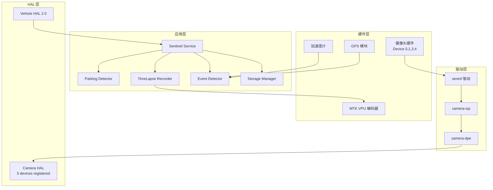

# 系统架构详解

## 总体架构



## 组件说明

### 1. Parking Detector (停车检测器)

**职责**: 监听 Vehicle HAL 信号，判断是否进入露营模式

**触发条件**:
- `Ignition: OFF` (点火关闭)
- `Gear: P` (驻车档)
- `Door: All Closed` (车门全部关闭)

**代码位置**: `app/src/main/java/com/sgmw/sentinel/ParkingDetector.java`

```java
public class ParkingDetector implements IVehicleCallback {
    private IVehicle vehicle = IVehicle.getService();
    private boolean isParkingMode = false;
    
    public void startListening() {
        vehicle.readVehicleSignal(0x100, this); // Ignition
        vehicle.readVehicleSignal(0x101, this); // Gear
        vehicle.readVehicleSignal(0x102, this); // Door status
    }
    
    @Override
    public void onVehicleSignalChanged(int signalId, ParcelValue value) {
        if (signalId == 0x100 && value == OFF) {
            if (isGearParked() && allDoorsClosed()) {
                enterParkingMode();
            }
        }
    }
}
```

### 2. Sentinel Service (哨兵服务)

**职责**: 前台服务，管理整个哨兵系统的生命周期

**关键特性**:
- 前台服务 (`startForeground`) 防止被系统杀死
- WakeLock 保持 CPU 唤醒
- JobScheduler 定时任务调度

**代码位置**: `app/src/main/java/com/sgmw/sentinel/SentinelService.java`

```java
public class SentinelService extends Service {
    private PowerManager pm;
    private PowerManager.WakeLock wakeLock;
    
    @Override
    public int onStartCommand(Intent intent, int flags, int startId) {
        // 获取 WakeLock
        pm = (PowerManager) getSystemService(POWER_SERVICE);
        wakeLock = pm.newWakeLock(PowerManager.PARTIAL_WAKE_LOCK, "sentinel:lock");
        wakeLock.acquire();
        
        // 显示前台通知
        Notification notification = createNotification();
        startForeground(1, notification);
        
        return START_STICKY;
    }
}
```

### 3. TimeLapse Recorder (缩时录制器)

**职责**: 实现 1fps 缩时录制和 30fps 事件录制的切换

**技术参数**:
- 正常模式：1fps, H.265, 1920x1080
- 事件模式：30fps, H.265, 1920x1080
- 存储路径：`/mapdata/SENTINEL/`

**代码位置**: `app/src/main/java/com/sgmw/sentinel/TimeLapseRecorder.java`

```java
public class TimeLapseRecorder {
    private CameraManager cameraManager;
    private MediaCodec encoder;
    private int frameRate = 1; // 默认 1fps
    
    public void startRecording() {
        // 配置 CameraCaptureSession
        cameraManager.createCaptureSession(captureList, sessionCallback, null);
        
        // 配置 VPU 编码器
        MediaFormat format = MediaFormat.createVideoFormat(
            MediaFormat.MIMETYPE_VIDEO_HEVC, 1920, 1080);
        format.setInt(MediaFormat.KEY_FRAME_RATE, frameRate);
        format.setInt(MediaFormat.KEY_BIT_RATE, 2000000);
        
        encoder = MediaCodec.createEncoderByType(
            MediaFormat.MIMETYPE_VIDEO_HEVC);
        encoder.configure(format, null, null, 
            MediaCodec.CONFIGURE_FLAG_ENCODE);
        encoder.start();
    }
    
    public void switchToEventMode() {
        frameRate = 30; // 切换到 30fps
        resetEncoder();
    }
}
```

### 4. Event Detector (事件检测器)

**职责**: 检测震动、位移、声音等事件，触发高帧率录制

**检测阈值**:
- 震动：G 值变化 > 0.5G
- 位移：GPS 位移 > 5m
- 声音：音量 > 60dB

**代码位置**: `app/src/main/java/com/sgmw/sentinel/EventDetector.java`

```java
public class EventDetector {
    private Accelerometer accel;
    private GPS gps;
    private AudioRecorder audio;
    
    public boolean isVibrationEvent() {
        float[] values = accel.getValues();
        float magnitude = Math.sqrt(
            values[0]*values[0] + 
            values[1]*values[1] + 
            values[2]*values[2]);
        return Math.abs(magnitude - 1.0f) > 0.5; // G 值突变
    }
    
    public boolean isMovementEvent() {
        float[] lastPos = gps.getLastPosition();
        float[] currentPos = gps.getCurrentPosition();
        return distance(lastPos, currentPos) > 5; // > 5m
    }
}
```

### 5. Storage Manager (存储管理器)

**职责**: 管理循环录制文件，实现紧急锁定机制

**策略**:
- 保留最近 7 天视频
- 循环覆盖最旧文件
- 标记为 `event_` 的文件不删除

**代码位置**: `app/src/main/java/com/sgmw/sentinel/StorageManager.java`

```java
public class StorageManager {
    private static final String SENTINEL_PATH = "/mapdata/SENTINEL/";
    private static final int MAX_FILE_SIZE = 7 * 1024 * 1024 * 1024; // 7GB
    
    public void manageStorage() {
        File dir = new File(SENTINEL_PATH);
        File[] files = dir.listFiles((f, name) -> name.endsWith(".mp4"));
        
        if (files != null) {
            Arrays.sort(files, (a, b) -> 
                Long.compare(a.lastModified(), b.lastModified()));
            
            long totalSize = 0;
            for (File f : files) totalSize += f.length();
            
            // 循环覆盖非紧急文件
            while (totalSize > MAX_FILE_SIZE && files.length > 0) {
                File oldest = files[0];
                if (!oldest.getName().startsWith("event_")) {
                    oldest.delete();
                    totalSize -= oldest.length();
                }
                files = Arrays.copyOfRange(files, 1, files.length);
            }
        }
    }
}
```

## 数据流

```
1. 停车触发
   Vehicle HAL → Ignition:OFF + Gear:P → ParkingDetector
   → SentinelService.start()

2. 缩时录制启动
   SentinelService → TimeLapseRecorder
   → Camera2 API (Device 0/1/3/4) → MTK VPU H.265
   → /mapdata/SENTINEL/sentinel_YYYYMMDD_HHMMSS.mp4

3. 事件检测
   EventDetector (持续监控)
   → 检测到震动/GPS 位移/声音
   → TimeLapseRecorder.switchToEventMode()
   → 30fps 录制 10 秒
   → event_YYYYMMDD_HHMMSS.mp4 (紧急锁定)

4. 存储管理
   StorageManager (定时任务)
   → 检查总大小 > 7GB
   → 删除非 event_ 的旧文件
   → 保持最近 7 天视频
```

## 权限需求

```xml
<manifest>
    <!-- 摄像头 -->
    <uses-permission android:name="android.permission.CAMERA" />
    
    <!-- 前台服务 -->
    <uses-permission android:name="android.permission.FOREGROUND_SERVICE" />
    <uses-permission android:name="android.permission.WAKE_LOCK" />
    
    <!-- 存储 -->
    <uses-permission android:name="android.permission.WRITE_EXTERNAL_STORAGE" />
    
    <!-- 车辆信号 (需要系统签名) -->
    <uses-permission android:name="com.sgmw.permission.VEHICLE_SIGNAL" />
    
    <!-- 音频 (事件检测) -->
    <uses-permission android:name="android.permission.RECORD_AUDIO" />
</manifest>
```

---

**Co-Authored-By**: Claude Code <noreply@anthropic.com>
🤖 Generated with [Claude Code](https://claude.com/claude-code)
